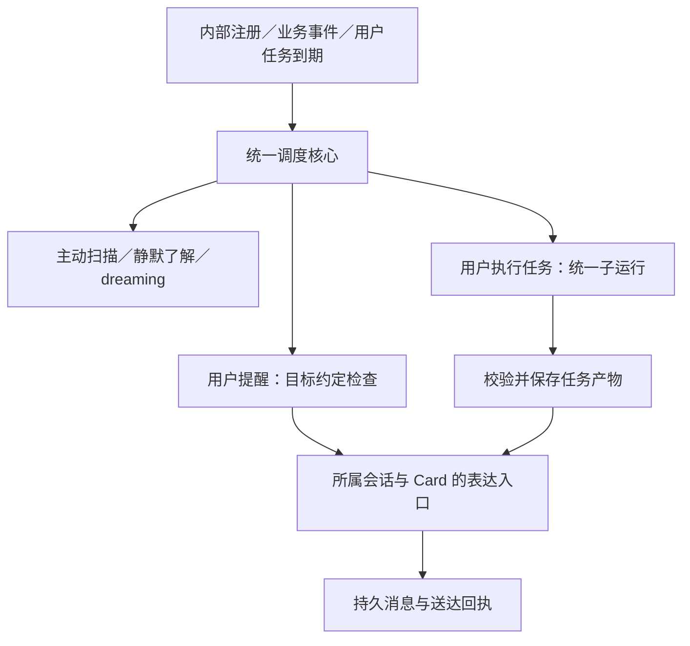

# 统一调度与子运行执行方案

> 归档：2026-10-18。代码、单元 133/923、集成 111/357、Rust 1038/1 ignored、契约 20、纪律扫描 0 与全量严格 E2E 80 场景/240 trial ×3 全通过（930 个跨层 caseId）已验收。审查发现的 P0 已修复：统一结果壳、complete/cancel 不携带 `taskPatch`、reschedule 不携带 `recurrence`、陈旧定时机会不霸占扫描、并发 occurrence 独立取消所有权。P1/P2 遗留见[未完成总表](../../plans/active/未完成工作与已知缺口.md) §11；Windows/真实桌面未验证。本文封存，不再更新。

本文汇总本轮已确认的内部调度、用户定时任务、复杂任务执行与子运行统一设计，作为后续实施的目标契约。**当前已获授权实施，正在收齐代码、测试与接线；测试统一留最终验收，进度及结果以未完成总表 §11 为准。**

本轮用户明确要求将讨论收敛到 active 中的一份方案。正文保存完整目标、实施依赖与验收设计；动态进度、剩余问题和验收结果只在[未完成工作与已知缺口](../../plans/active/未完成工作与已知缺口.md)第 11 节记账。不得把本文件的目标描述当成当前产品能力，也不得把历史测试结果当成本方案的验收证据。

## 1. 范围与已确认边界

目标：统一业务唤醒与子运行执行机制，让用户能用自然语言创建、查询、修改和取消自己的提醒及执行型任务，同时保留现有陪伴设计。

| 对象 | 调度与执行 | 用户及 LLM 可见范围 | 修改入口 |
|---|---|---|---|
| 主动扫描、静默了解、dreaming | 程序内部注册，共用内部调度核心 | 不进入用户任务列表、任务工具、用户任务管理上下文或普通任务结果 | 现有业务设置入口，内部代码 |
| 用户提醒、约定 | 用户任务领域提供到期条件，主动领域交付 | 当前用户／Card／会话允许范围内可见 | `schedule_query`、`schedule_change` |
| 用户执行型任务 | 调度核心启动统一子运行，结果持久化后由所属 Card 交付 | 当前允许范围内的任务、运行摘要和结果可见 | 同一组用户任务工具 |
| fork／team、计划步骤、主动规划 | 共用现有子运行执行内核与统一协议 | 模型可使用普通委派工具；内部用途、owner 和策略由宿主绑定 | 各业务入口，统一子运行协议 |
| 一次性模型调用 | 继续经 `completePiText` 与同一模型网关执行 | 沿用原业务边界 | 原业务入口 |

必须保留：

- 主动消息的随机检查区间、现有事件唤醒与重排、普通话题发送后的随机间隔。
- 静默时间、忙碌判断、每日次数、未回复抑制、冷却、Card／会话归属、取消与回执终裁。
- 静默了解和 dreaming 的独立档位、固定钟点与 15 分钟追赶窗口；两者继续独立运行。
- 用户提醒的来源约束、版本校验、事项改期与提醒延后的区别。
- Card 决定角色表达，拟人化开关决定既有表达行为；关闭拟人化仍保留 Card 人设。
- 程序只有一个 Node Harness、一个 SQLite 连接所有者和现有 Harness 内核；不增加第二套 Agent Loop。
- 系统任务的内部诊断只走日志、trace 与开发诊断，不通过用户任务工具间接泄露。
- 不新增面向用户的系统任务管理页，不通过任务工具调整系统档位或删除内部处理器。

本方案不包含系统 cron／操作系统任务计划接入；应用退出或系统睡眠期间不承诺后台继续运行。真实 CONFIG、用户数据清理、提交、推送和发布须遵守当前授权，不由本文自动授权。

## 2. 当前源码基线

下表只说明本轮核对到的当前实现；其他章节描述目标。

| 当前事实 | 源码入口 |
|---|---|
| dreaming 自持 15 秒检查定时器，最近自动尝试时间只在内存；作业、租约与水位由记忆域持有 | [dreaming.ts](../../../src/services/agent/memory/dreaming.ts) |
| 静默了解自持 60 秒检查定时器，最近尝试时间持久化在了解层文件 | [observation/scheduler.ts](../../../src/services/observation/scheduler.ts)、[store.ts](../../../src/services/observation/store.ts) |
| 主动扫描使用递归随机 setTimeout，并接收窗口、变量、会话等事件；未按最近提醒到期时间安排独立唤醒 | [scanner.ts](../../../src/services/proactive/scanner.ts) |
| 静默了解与 dreaming 共用钟点判定；档位常量来自协议生成链 | [schedule.ts](../../../src/services/proactive/schedule.ts)、[protocol.json](../../../src/services/proactive/protocol.json) |
| 当前模型工具是 proactive_query／proactive_change，修改工具含控制操作；查询与修改能力尚非本方案的完整 CRUD | [proactive.ts](../../../src/services/tool/local-extra/proactive.ts)、[registry.ts](../../../src/services/tool/registry.ts) |
| 提醒、主动尝试、额度、去重与回执由 Rust 维护，与记忆同库同连接 | [proactive/schema.rs](../../../crates/native-host/src/proactive/schema.rs)、[store.rs](../../../crates/native-host/src/proactive/store.rs) |
| fork、team、计划步骤和主动规划已共用 runPiSubAgent；普通 fork 工具集固定为读取、系统信息和 Bash | [sub-agent.ts](../../../src/services/agent/sub-agent.ts)、[runtime.ts](../../../src/services/engine/harness/runtime.ts)、[planner.ts](../../../src/services/engine/planner.ts) |
| 普通子运行未指定思考强度时默认 low；模型使用辅助模型，未设置则回落聊天模型 | [runtime.ts](../../../src/services/engine/harness/runtime.ts)、[model-gateway.ts](../../../src/services/engine/harness/model-gateway.ts) |
| team 目前返回字符串，工具层直接包装成功；子运行结束与业务成功尚未统一表达 | [sub-agent.ts](../../../src/services/agent/sub-agent.ts)、[agent-tool.ts](../../../src/services/tool/local-extra/agent-tool.ts) |
| 子运行使用临时槽，默认不保存完整任务结果；主动表达已有 Card、忙碌检查、持久消息与送达回执链 | [runtime.ts](../../../src/services/engine/harness/runtime.ts)、[runner.ts](../../../src/services/agent/runner.ts) |
| 周期提议接受逻辑会按工具名读取历史成功调用，工具改名必须同步 | [proactive/index.ts](../../../src/services/proactive/index.ts) |

当前固定钟点：

| 档位 | 静默了解／dreaming 的本地钟点 | 主动扫描随机检查区间 |
|---|---|---|
| 低 | 12:00、20:00 | 2–5 小时 |
| 中 | 10:00、14:00、18:00、22:00 | 30–90 分钟 |
| 高 | 09:00、11:00、13:00、15:00、17:00、19:00 | 10–30 分钟 |

表中数值是源码基线。实现继续引用已有协议与配置单点，不在新调度器重复定义数值。

## 3. 总体结构与所有权

内部调度核心只处理注册、期限、触发、单飞、取消和排空。是否具备业务资格、允许哪些工具、如何提交及是否送达，由所属领域裁决。



| 数据 | 唯一所有者 | 调度器的取用方式 |
|---|---|---|
| 业务频率、静默设置 | CONFIG 与类型化 getter | 读取派生策略；不在调度表保存第二份设置 |
| 用户任务正文、周期、时间、来源、版本 | 用户任务领域，沿用 proactive_tasks 的权威职责 | 取得到期投影；不复制任务定义 |
| dreaming 作业、租约、候选、游标、水位 | 记忆域与 MemoryStore | 保存关联身份；结果以记忆事务为准 |
| 主动机会、尝试、额度、去重、送达 | 主动领域与 Rust 账本 | 请求业务准入与交付；不自行判成功 |
| 固定系统任务的槽位认领 | 内部触发账本，共用 MemoryStore 连接 | 原子认领和对账；不向任务工具暴露 |
| 执行型用户任务的本次运行与产物 | 用户任务运行记录 | 关联任务版本、occurrence、执行及交付身份 |

内部触发账本只记录调度事实，不重复业务租约、记忆水位或消息成功状态。其认领、开始、结束及未确认状态要能区分；不得宣称跨 SQLite／JSONL／模型请求存在一次事务。

## 4. 内部调度核心

### 4.1 注册与生命周期

新增 `src/services/scheduler/`，提供程序内部的注册、更新期限、事件通知与停止排空入口。

- 内置处理器只能由启动代码登记，工具参数中不存在系统任务类型、内部处理器名称或任意回调入口。
- 维护一个最近到期的业务唤醒定时器；网络超时、动画和其他非业务计时器继续归原模块。
- 各处理器使用自己的执行键和取消域；不把所有业务串成一个全局互斥队列。
- 静默了解、dreaming 各自单飞，可以按现有设计独立执行。
- 随机扫描与提醒交付共用主动领域的执行互斥、claim 与 occurrence 去重。
- 启动前先完成对应路径、配置、工具、owner、窗口观察等依赖接线。启动后主动检查一次，固定任务检查当前是否在追赶窗口内。
- 配置变更经既有刷新入口更新调度期限、取消或停止相关运行；不建立第二份配置写入口。
- 系统恢复、墙钟或时区变化时重算期限；不按过期延迟批量追发。
- 关停顺序：关闭新触发准入 → 取消活动运行 → 等待领域排空 → 刷写账本、会话和日志 → 释放资源。

### 4.2 主动扫描随机性

- 下次随机时间仍由主动业务根据当前档位抽取；调度核心只安排唤醒。
- 现有窗口、解锁、变量、会话、Card 和配置事件沿用当前唤醒与重排语义。
- 普通话题／好奇成功发送后的随机间隔继续由 Rust 账本持有。
- 随机检查、产生机会和真正发送是三个不同阶段；工具或 UI 不把下次检查描述成保证发消息的时间。
- 用户提醒到期只进入 `reminders_only` 检查，不顺带生成随机话题，不消耗、重抽或推迟原随机检查期限。
- 随机检查和提醒同时到期时，保留主动业务优先级；同一 occurrence 只交付一次。

### 4.3 固定钟点与防重

- 静默了解／dreaming 继续使用当前钟点表、本地时区和 `[整点, 整点+15分钟)` 窗口。
- 系统任务在取得实际执行资格时才认领槽位；仅检查到 busy 或观察不可用，不算已经执行。
- 窗口内暂不具备资格时，按原业务检查节奏或可用性事件安排下一次检查；过窗等待下个合法槽。
- 两域分别认领、记账，不强加“先静默了解，再 dreaming”的依赖。
- 固定槽必须有跨重启稳定身份，覆盖本地日期、钟点、时区／DST 对应关系，并防止时钟回拨重复消费。档位刷新不能使已尝试槽再次执行。
- 去掉 dreaming 的纯内存自动尝试防重与了解层文件中的调度尝试字段；统一由内部触发账本持有调度事实，了解内容仍由观察域持有。
- 调度认领后发生崩溃，要关联实际作业／辅助预留对账；无法证明开始或结果的记录明确留未确认状态，不伪报成功或盲重放。
- 业务失败是否已经消费本槽，以已有尝试准入语义为准；不因新调度器引入无限模型重试。

### 4.4 提醒到期与阻塞

用户任务领域提供当前允许范围内的最近到期投影，提醒专用入口检查目标，不自动切换会话或 Card。

| 情况 | 后续行为 |
|---|---|
| 用户回合／lane 忙 | 等通道释放后复核，不抢占用户输入 |
| 静默时段、冷却 | 在边界结束后复核 |
| 暂停、主动档位关闭 | 保留约定，恢复后只检查仍有效窗口 |
| 当前 owner 不符合 | 等归属可用，不把结果发到其他会话 |
| 完成、取消、失效或超窗 | 停止该 occurrence，保留真实状态 |
| 已提交／提交未知 | 对账，禁止自动重复交付 |

提醒及执行型任务的自动启动、交付沿用前面确认的主动关闭／暂停语义。系统任务的独立档位不受用户任务工具控制。

## 5. 用户任务定义与自然语言参数

### 5.1 任务种类与字段

用户任务只包含 `reminder`（提醒／约定）与 `agent_job`（执行型任务），不含任何内置系统任务类型。创建和修改均落到最终格式，不引入旧格式双读、双写或兼容工具别名。

| 字段职责 | 内容 |
|---|---|
| identity／scope | taskId、version、所属用户／Card／session；运行时确定并校验 |
| intent | 用户希望完成的事情与目的，保留原指示证据；不把未来台词写成固定模板 |
| schedule.calendar | 一次性／日／周／月／年、日期筛选、明确 IANA 时区 |
| schedule.trigger | 固定时刻、窗口、相对时间锚或受支持事件 |
| schedule.count | 每周期固定次数，或随机整数范围；明确按日、周等哪一周期计数 |
| schedule.spacing | 同周期多次触发的最小间隔 |
| schedule.validity | 开始、结束／长期有效；“以后每天”可以持续到取消，不强制要求截止日 |
| schedule.missedPolicy | 允许窗口内延后或本次跳过；不得突破发送门禁 |
| work | 执行型任务的目标、必要输入、能力、产物和完成条件 |
| execution | 已确定的思考档位；其他生效预算由统一策略解析 |
| delivery | 目标会话、Card、有效交付窗口与结果表达要求 |
| evidence／authorization | 本轮可信用户事件、记忆引用／版本或已确认 proposalId；身份由运行时绑定 |

这是目标字段职责，实际 TS／JSON Schema／Rust 形状在同批实施中统一生成和逐项对齐。禁止创建第二个 owner、时区或任务时间权威字段。

### 5.2 时间、锚点与事件

| 用户描述 | 规范化方式 | 创建要求 |
|---|---|---|
| 每周五 20:00 提醒交周报 | 每周五、固定 20:00、一次 | 完整明确指令可直接授权 |
| 每周五提醒一下 | 周期明确，目的或时间尚不明确 | 结合上下文提出安排；必要时询问 |
| 每天下班提醒运动 | 已确认作息时间锚，或支持的工作结束观察事件 | 先分清固定作息与实际事件 |
| 晚上随机聊聊 | 已确认晚间窗口、随机时间和次数 | 不自行扩展成全天或每天多次 |
| 每天随机提醒一到三次 | 每日周期、随机次数、允许窗口和间隔 | 补齐影响用户体验的缺失信息 |
| 下班后两小时内随机提醒一两次 | 下班锚点、相对窗口、随机次数 | 锚点与观察能力需确认 |

- “周一至周五”不自动等于用户工作日；排班、法定调休不能由普通日历常识补造。
- 日期、时区、月底、闰日和 DST 处理复用当前时间领域规则；日历周期不以固定 24 小时模拟。
- 跨午夜窗口必须能确定归属周期、起止日期与时区，不能只比较两个 HH:mm。
- 用户时区约定是任务参数；系统时区变化触发重算，但不能暗中改写用户明确选择的任务时区。
- 当前工作结束信号是工作状态转为休闲／空闲后的推测，不是现实下班证明。
- 对实际事件型任务，必须确认可观测信号、观察关闭／失效时的行为；没有信号时不伪造发生，也不偷偷退化成固定时刻。
- 若项目能力不足以满足“实际下班”，返回限制并讨论用户愿意采用的替代安排，不能强制创建。

### 5.3 随机时间与随机次数

示例原指令：“每天 18:00–22:00 随机提醒起来走走，一到三次，至少间隔半小时。”目标表达如下：

```json
{
  "kind": "reminder",
  "intent": "提醒起来走走",
  "schedule": {
    "calendar": { "frequency": "daily", "timezone": "Asia/Shanghai" },
    "trigger": {
      "kind": "window",
      "start": "18:00",
      "end": "22:00",
      "selection": "random"
    },
    "count": { "kind": "random", "min": 1, "max": 3, "per": "day" },
    "minGapMinutes": 30,
    "missedPolicy": "within_window"
  }
}
```

- 随机次数默认在确认范围内均匀取整数；零次只有在用户明确接受时才允许。
- 每个周期只抽取一次目标次数与窗口内时间点，并将周期身份、任务版本和抽样结果持久化。
- 随机时间满足窗口、最小间隔和已有约束；重启、查询、失败重试不重新抽签。
- 用户说“提醒几次”按目标送达次数理解；计划次数、执行尝试与成功送达分别记账。一次 occurrence 的重试不增加成功次数。
- 应用未运行、静默、暂停、额度或不可用能力仍可能使目标未完成；窗口结束记录未送达，不集中补发，不宣称次数已保证。
- 任务修改后撤销旧版本尚未执行的安排，依据新授权生成新版本计划；提交或提交未知的旧结果继续按原身份对账。
- 用户任务的随机计划与系统主动扫描随机性独立，前者不能改变后者的节奏。

### 5.4 使用记忆补参

- 记忆只提供带来源和版本的候选参数，不替代用户当前授权。
- 可信且仍适用的作息可用于提出“按这个时间安排”的具体方案；画像推测、敏感推断或陈旧信息不能直接写成确定事实。
- 补充了关键时间、频率、次数、观察条件或目的时，要让用户了解该解释并同意后创建。
- 已确认参数保存为任务约定；未来记忆变化不自动改变任务，需走任务更新与授权。
- 用户已经给出完整创建指令时，不额外强制二次确认；用户明确委托可选范围时在该范围内规范化。
- 必要记忆通过现有 MemoryProvider 治理边界提供，不伪造“本轮可信用户事件”以绕过记忆查询或写入限制。

## 6. 工具、校验、确认与创建回复

### 6.1 模型工具面

模型工具直接替换为 `schedule_query` 和 `schedule_change`，不保留 proactive 工具兼容别名。领域内部 proactive_* 的扫描、回执与控制端口继续承担其职责，复用同一事务实现。

| 工具 | 行为 |
|---|---|
| schedule_query | 按当前归属分页查询用户任务；支持状态、精确 ID 和最近结果查询，返回稳定 cursor、id/version、规范化安排与可理解状态 |
| schedule_change | propose／create／update／reschedule／snooze／complete／cancel |

限制：

- 不提供系统任务类型、系统档位、任意 handler、任意 CONFIG 字段或全局控制 action。
- 查询不连接内部注册表或触发账本；系统任务 ID 无法成为有效查询或修改目标。
- TS 参数校验与 Rust 用户任务命令面同时收窄 action／字段／scope；不能只靠 Prompt 或过滤 UI。
- 新增、修改绑定本轮可信用户来源；修改带 expectedVersion，创建与提交具有稳定 operationId。
- update 只修改明确提供的允许字段；周期变更与新建周期使用同一同意验证。
- reschedule 改事项时间及相应权威锚；snooze 只改下次提醒，保留事项时间与原有效期。
- complete 不能把模型执行或消息送达冒充用户现实事项完成。
- cancel 是取消并留审计记录；不新增物理删除工具。
- 保留现有任务数量、周期数量和单次规划新增数等容量终裁；参数扩展不绕过容量限制。

### 6.2 三层校验

| 层 | 检查内容 | 不通过时 |
|---|---|---|
| 结构与逻辑 | 类型、枚举、时区、日期、窗口、次数、周期、间隔、目标版本 | 拒绝非法参数或返回缺失项 |
| 可执行性 | 必需能力、模型能力、授权、可观测事件、窗口容量、额度和任务容量冲突 | 返回冲突／不支持／需要授权，不静默降级 |
| 需求对应 | 目的、时间前后关系、频率、随机范围、输出要求是否对应用户原话 | 澄清或形成具体提议，确认后创建 |

“半小时内三次且至少间隔二十分钟”属于逻辑不可执行；随机范围的最大次数超出现有可用额度时，要显式处理冲突，不能偷偷减少次数或修改系统设置。

程序负责可证明的参数和边界校验；LLM 结合原话、证据与工具生成的可读安排检查语义。不能把模型自报“符合需求”当成代码证明。用户确认的解释必须绑定实际参数，避免口头安排与执行参数不一致。

### 6.3 提议与创建闭环

1. 主模型理解需求，必要时通过合法记忆入口补充候选信息。
2. propose 可接收未完成草案，返回缺失项、可读安排、限制、冲突及 proposalId；不进入执行队列。
3. 信息不足返回 needs_clarification；涉及推断安排返回 needs_confirmation；无法执行返回 rejected／conflict。
4. 用户明确同意具体提议后，按 proposalId、内容指纹、来源版本和 owner 精确接受；多个提议有歧义时不猜。
5. create 只接受完整有效参数，并在提交前复核授权、版本和能力。
6. 工具返回真实提交结果；结果未知先查 operationId，不重复创建。

“好，就这样”等简短同意只能接受仍有效且对应的提议。确认后关键参数变化必须重新核对。提议复用现有成功工具交换与后续用户同意的证据机制，改工具名时同步历史调用解析。提议不是运行许可、权限许可或事项已经创建的证明。

澄清、计划确认与危险操作许可继续使用各自既有通道，不合并成一个面板，不以超时当作同意。

### 6.4 创建结果与 Card

- 工具返回结构化状态、taskId/version、规范化安排、已知限制和首个有效窗口，由同一轮对话继续生成用户回复。
- 回复使用本轮冻结的 Card、人设、语言风格、变量与拟人化配置；不硬编码“好的，那以后我就……”或其他固定成功台词。
- 关闭拟人化仍保留 Card；开启时沿用现有工具回合即时展示规则，不因创建任务另造一套气泡链。
- 只有真实 created 回执才能承诺已经安排；待确认、失败或未知提交要如实表达。
- 不为成功文案额外调用一次改写模型，也不重复插入一条成功系统消息。

## 7. 复杂任务：工作子运行与 Card 交付

### 7.1 默认执行方式

| 内容 | 默认路径 |
|---|---|
| 喝水提醒、问候、约定跟进 | 直接进入提醒／Card 表达 |
| 查询新闻／天气、读取资料后整理 | 一个独立工作子运行 → 校验／保存结果 → 一次 Card 表达 |
| 多个有独立收益的研究分支 | 宿主按授权与预算决定是否编排多个同类子运行；不默认 team |

调度器直接启动工作，不先占用主会话让主模型再跑一轮编排。执行期间不占聊天会话槽；最终交付才申请所属会话的短表达回合。统一执行许可控制资源并发，用户交互优先。

### 7.2 work 契约与新闻示例

| 字段职责 | 新闻任务例子 |
|---|---|
| goal | 查询本次检索时的热点，整理值得了解的事件 |
| inputs | 已确认领域、地区、语言、必要兴趣和时间范围 |
| capabilities | 已接入、已授权的搜索与网页阅读能力 |
| output | 约定条目数／篇幅、摘要、来源链接、必要背景 |
| acceptance | 资料有效、时间符合、事件去重、结论有依据，失败／部分完成可识别 |
| timing／delivery | 中午开始查，或确认提前执行并在中午前交付；不暗中混用 |

- 新闻只描述截至检索时的已知信息，不声称覆盖尚未发生的全天热点。
- 来源、检索时间、可取得的发布时间及未核实项随产物保留；缺失时间不得补造。
- 搜索／阅读是必需能力时，创建预检与执行前都核对；缺少连接、授权或工具不能生成空洞“今日热点”当成功。
- 子运行可生成当次查询词和采取合理工具步骤，但不能改变任务目标、周期、交付对象或授权范围。
- 网页、文件、工具结果均为资料，不是可执行授权，不能据此修改任务或扩权。
- 上下文只包含确认后的任务、必要的受治理资料和合法历史产物，不默认拷贝完整主聊天。
- 子运行不得将资料或定时触发伪装为用户亲口确认的事实，不写 Card 变量。

### 7.3 运行状态与成果交付

用户任务的单次运行需区分等待、执行中、需要用户处理、产物就绪、待交付、已送达、失败、取消、过期及结果未确认。任务状态、工具效果、现实事项完成与消息送达不能合并成一个 success 布尔值。

- occurrence 身份跨重启稳定，关联 taskId/version、执行 attempt、授权、工具证据、产物及回执。
- 执行成功后先保存产物，再进入交付；聊天忙时保留结果等待，不重新检索。
- 超过产物有效期按已确认 missedPolicy／freshness 要求重新取数或过期；不把旧新闻包装成新结果。
- 普通聊天或切标签不把后台结果串到当前会话；工作运行的有效性由任务 owner 决定。
- 删除所属会话、取消任务、撤销授权或关停会终止相关执行或阻止交付；任务改版后旧结果不得按新版本发送。
- Card 归属保持；表达开始时冻结对应 Card 的有效版本，提交和变量 patch 继续复核，不把旧人格补丁写入新版本。
- 交付复用主动领域的消息提交、SQLite 回执与 JSONL 对账；主表达工具面为空。
- 新闻简报等无需回应的自足结果默认 expectsReply=false，避免错误累积未回复抑制。
- 表达使用真实产物和来源，可按 Card 改变语气，但不能添加不存在的事实或把部分完成说成全部完成。
- 已提交消息未知回执先对账；不得因为交付失败把已经成功的工作再次执行。

### 7.4 无人值守能力与授权

- 创建时确认的是任务目标及允许的工作范围；后续 occurrence 引用任务级授权，不伪造新的可信用户事件，也不借用已失效聊天代际的 grant。
- 新增任务级许可 owner，继续经过现有 PermissionKernel、工具策略和 Rust 最终裁决；MCP annotations 不会自动把 DANGER 变 SAFE。
- 工具集按需要、授权和系统允许范围构建，不直接复制 fork 的固定 Bash 集合，也不把全部 MCP 下放。
- 必需授权或信息缺失时进入 needs_input／needs_authorization，释放执行资源，等待用户处理；后台不无限挂起确认面板。
- 首批必须打通查询、阅读、整理、总结。写入、外发等效果只有在持久授权及参数范围可验证时才可执行；未定义的授权范围保持阻塞，不因“复杂任务”自动放权。
- 只读工作可按明确策略重试；已知／未知副作用与消息提交遵守现有幂等和未知效果恢复纪律。

## 8. 子运行统一协议

### 8.1 一个内核与业务入口

沿用 `runPiSubAgent` 作为唯一子运行执行入口，统一其请求、策略解析、生命周期和结果协议。fork／team 只保留宿主编排职责，不再各自决定一整套运行语义。

| 用途 | owner | 必须保留的业务差异 |
|---|---|---|
| 普通 fork／team 委派 | 父会话／父回合 | 父取消级联；工具来自受限委派范围 |
| 计划步骤 | Plan／step／父运行 | 顺序、逐步确认、暂停恢复与未知副作用规则 |
| 主动规划 | 主动运行及 Card／会话 | 有限工具、low、JSON 决策、预算准入与来源校验 |
| 定时执行 | taskId/version／occurrence／run | 独立于当前聊天代际，任务授权、产物与交付持久化 |

用途、owner 和生效策略由宿主绑定，模型不能通过 agent_spawn 自报内部用途取得权限。无会话的内部工作也须有明确内部 owner，不能以无 owner 加永远为真的 isCurrent 绕过检查。

### 8.2 统一请求与解析

| 请求职责 | 内容 |
|---|---|
| owner | 稳定身份、父子关系、失效条件、取消域与授权引用 |
| task／context | 工作目标、必要上下文与合法证据 |
| capabilities | 必需／可选工具能力与参数范围 |
| execution | 模型策略、思考强度、deadline、maxToolCalls、输出预算 |
| outputContract | 文本／结构化产物、校验要求与证据需求 |
| audit | 同一 trace/run 身份及所属业务持久化位置 |

- 启动时统一解析并冻结有效配置、模型身份、工具快照和预算，模型网关与 Harness 循环继续复用。
- 接口 `maxRounds` 的实际含义收敛为 `maxToolCalls`；同步所有消费者和测试，已有配置数值的含义不改变。
- 默认值引用所属模块配置或统一策略单点；不把所有业务强行设为同一时限、思考强度或工具范围。
- beforeProvider 等业务准入继续由所属领域提供，统一生命周期保证执行，不创建平行预算账本。
- 工具名单从注册表真实描述符解析；统一做授权、参数风险、模型能力、必需能力和 MCP 生命周期检查。
- 当前计划必需工具缺失时不开工、主动规划可选工具缺失时降级的差异保留。
- 子运行继续剥离派生／delegate 工具，不自行再开代理；team 成员与汇总由宿主编排。
- 统一子运行不能把内部主动规划放大成有搜索 MCP 的通用任务。

### 8.3 统一结果与成功判定

统一结果外壳至少包含运行状态、文本／结构化产物、工具执行证据、用量、错误与审计引用；允许标记部分完成和未确认效果。

- 明确完成、取消、超时、需要输入、失败，不把空正文兜底文字视为业务成功。
- Harness 正常结束只证明运行结束；结果是否满足需求由 outputContract 与领域验收决定。
- team 保存成员状态，汇总失败不能包装成功；部分成功需明确未完成项。
- 普通委派、Plan 和定时任务采用相同审计身份，按所属领域落盘；不为所有短期调用复制完整聊天记录。
- 所有终止路径统一释放槽、取消监听、执行许可与 MCP owner；父取消和任务取消都能中止正在执行的工具。
- 复杂任务最终消息及 Card 变量提交继续走主表达链，子运行不直接推送聊天或写角色状态。

### 8.4 思考强度与模型

用户定时执行任务在创建时确定并保存 `execution.thinkingEffort`，每次执行照该参数解析。任务修改可重新评估，失败不自动升档。

| 档位 | 默认适用工作 |
|---|---|
| low（默认） | 查询新闻／天气、资料提取、常规摘要 |
| medium | 多来源核对、多条件分析、方案比较 |
| high | 明确要求深入研究或复杂推理的任务 |

- 创建时主模型依据目标建议，用户明确要求优先；工具校验档位与预算，不额外请求一次分类模型。
- 工具数量多或网络耗时长不直接代表需要更高思考强度；调用上限与时限分开管理。
- 首版任务保存 low／medium／high。现有 auto 表示服务端／模型默认，不把它复用成“按任务难度自动分类”。
- 子运行统一解析辅助模型，未配置辅助模型时回落聊天模型；模型在每次运行启动时冻结，任务不保存凭据。
- 单次运行记录期望档位、模型／provider、生效推理参数及适配情况；不同模型的同名档位不宣称等价。
- 模型能力变化需执行前校验；不支持的明确要求不能无声冒充满足。
- 定时工作档位与主表达分开，Card 表达继续使用当前主会话思考配置和既有人格规则。

### 8.5 一次性模型调用的边界

dreaming Review／合并、压缩、话题提取、人格阶段文案等没有工具循环的调用继续使用 `completePiText`，共享模型网关、取消、预算和用量接口。无需为这些调用额外创建子代理槽，也不另建循环。

## 9. 持久化、IPC 与恢复

- 新增内部槽位账本和用户任务运行记录时，共用现有数据库、MemoryStore 单连接与 schema/备份校验机制；不新增数据库或平行 JSON 任务定义。
- 系统触发状态与用户任务运行数据在命令访问范围上隔离；用户查询不能因共库而列出系统任务。
- 用户随机计划属于该任务周期的权威执行安排，重启原样恢复；任务定义仍只有一份。
- 用户任务创建／变更、系统槽位认领及运行状态转换使用稳定 operationId 和版本校验。
- 真实副作用和聊天提交结果未知时先查账；结果未知与确定未提交分别处理，过期租约不永久阻塞其他合法运行。
- 只读工作重试与产物再次交付分开；已就绪结果优先恢复交付。
- Task、Plan、主动链和记忆域保留各自业务状态所有权；公共审计关联它们，不重建一套领域状态机。
- 记录与产物有有界保留和清理策略，复用现有托管路径及保留机制；调度不能产生无界历史。
- 新命令／参数／结果在源协议、生成 TS/Rust、HostCommandMap、Rust dispatch、测试适配与 Contract sourceFiles 同批对齐。
- 删除、移动和改名执行 CodeGraph 与全仓字符串引用核对，覆盖动态导入、历史工具名解析、快照统计与测试夹具；不留下旧入口兼容层。
- 真实开发 CONFIG 和用户运行时数据本次不改；结构或模板变更按现有同步链实施，不能借方案执行擅自清库。

## 10. 文件落位与消费面

以下新增目录是目标落位，不表示现在已经存在。模块地图只在实现后同步到系统地图，本文只列本任务改动面。

| 改动面 | 目标工作 |
|---|---|
| `src/services/scheduler/`（新增） | 内部注册、最近期限、事件触发、单飞与关停；固定钟点纯计算从 proactive 叶子迁入公共位置，引用直接替换 |
| `src/services/proactive/scanner.ts`、`opportunities.ts`、`time.ts` | 拆出计时器；提供全量扫描与 reminders_only；保留随机、资格、时间和去重规则 |
| `src/services/observation/scheduler.ts`、`store.ts` | 业务批次保留，迁移定时器与调度尝试状态，保留观察清除与排空闭包 |
| `src/services/agent/memory/dreaming.ts`、`index.ts` | 保留 sweep／治理，删除分散自动调度状态与废弃 startIdle 命名入口 |
| `src/services/engine/harness/runtime.ts`、`index.ts`、`harness-slot.ts` | 统一子运行协议、配置冻结、owner、取消、工具生命周期及结果 |
| `src/services/agent/sub-agent.ts`、`timeouts.ts` | fork／team 宿主编排与统一结果；预算单点继续复用 |
| `src/services/engine/planner.ts`、`plan/proposal.ts`、`proactive/planner.ts` | 迁移统一请求与结果，保留领域规则；更新主动规划注入类型 |
| `src/services/tool/local-extra/proactive.ts` → `schedule.ts` | 最终模型工具、字段校验、提议、CRUD 与结构化回执；原工具定义删除 |
| `src/services/tool/registry.ts`、`local-extra/agent-tool.ts` | 新工具注册；普通委派入口统一；更新描述及 team 失败语义 |
| `src/services/proactive/index.ts` | 周期提议读取与工具名、反馈目标、owner、回执保持一致 |
| 用户任务 TS 编排模块（新增） | 定义/校验/能力预检、周期随机计划、执行型任务与产物交付，跨域只走公开 barrel |
| `crates/native-host/src/scheduler/`（新增）、现有 proactive/store | 内部触发账本、用户任务受限命令、运行记录、最近到期、分页与受限更新；共用 MemoryStore |
| `src/services/init.ts`、`src/harness/main.ts`、配置/设置刷新消费者 | 依赖就绪后的统一启动、任务恢复、停止排空与刷新，不并存两套定时器 |
| `src/services/host/types.ts`、Rust 分派与协议生成链 | 内部命令与用户受限命令对齐，不把内部权限通过工具透出 |
| `test/contracts/`、相关 unit/integration/e2e 与宿主适配 | 按真实边界补覆盖，更新 sourceFiles 和消费路径 |
| README、DES、相关 current 与 INDEX | 实现后同步行为、玩法、用户入口、数据库和模块导航；未实现前不宣传为可用 |

用户任务 TS 编排实现前先核对现有 proactive 的复用边界，确定一个公开归属点；不在 scheduler、proactive 和工具 handler 各建一份任务定义／校验。

本方案写作时工作区已有记忆检索、reader、trace 和相关契约改动。实施前按当时 git status/diff 重新确认交集，保留既有修改，不夹带回滚、清理或扩大记忆检索改造。

## 11. 三批实施与依赖

### 第一批：公共基础统一

- 统一现有子运行请求、owner、配置解析、工具装配、结果和取消/释放；先迁移 fork/team、计划步骤、主动规划。
- 建内部调度核心与固定系统槽位账本，迁移主动扫描、静默了解、dreaming。
- 接通启动、配置刷新、关停、恢复与时间变化；清除废弃计时器、状态和入口。
- 同步写针对权限、随机、槽位、生命周期和 team 失败语义的测试代码，按纪律先不运行。
- 交付形态：现有业务只走统一基础，保持本文件规定的业务行为；用户复杂任务尚不宣称完成。

### 第二批：用户任务与执行闭环

- 落地完整日历／锚点／事件／随机时间和次数模型，补参数、可执行性及需求对应校验。
- 落地 proposalId 确认、受限 CRUD、分页查询与最终工具名；补全部字符串消费者。
- 接最近到期与 reminders_only，落周期随机计划与任务级授权。
- 执行型任务使用统一子运行，打通搜索／阅读类 MCP owner、产物持久化、完成条件、恢复与 Card 交付。
- 保存任务思考强度，记录运行生效配置；补同轮 Card 创建回复，不增加固定台词或额外改写调用。
- 同步协议、配置模板（确有字段变化时）、业务 current、README/DES 和测试代码；实现期间不运行测试。
- 交付形态：从自然语言需求到创建、执行、结果与送达可完整追踪，内部系统任务始终不可见、不可修改。

### 第三批：集中验收

- 按测试域 SKILL 做 Contract analyze → generate 和覆盖审查，不能只刷 hash。
- 执行静态、打包、Rust、L2/L3、完整严格 L4 与跨层 caseId 对账。
- 隔离数据根启动实际桌面应用，采集计时、owner、取消、产物与回执证据。
- macOS 实机、Windows 编译/CI 与 Windows 实机分别记录；一种证据不能替代另一种。
- 只在未完成总表登记一次基线、范围、结果及未验证项，保持本文件的目标正文可追溯。

集中命令沿用现有入口；具体测试规则以 [test/AGENTS.md](../../../test/AGENTS.md)、[README](../../../test/README.md) 为准：

```bash
pnpm run build:harness
pnpm run check:bundle
pnpm run test:release
```

test:release 当前包含类型/cargo check、纪律与波动门禁、Rust、unit/integration 及全量严格 E2E ×3。纯文档落文不执行这些代码门禁；本次只做文档事实、链接、引用、格式和差异检查。

## 12. 验收设计矩阵

下表是实施需要建立的目标断言，不是测试结果。L2/L3 不使用真实 Provider，真实 Rust 边界放 L4；实际模型、Card 表达和新闻取数质量另作观测证据。

| 编号 | 场景 | 要证明的行为 |
|---|---|---|
| S01 | 系统注册表、用户查询、直接宿主请求 | 系统任务不进用户任务工具 schema、结果、管理上下文或用户列表；内部 ID、非法 action／字段不能越界 |
| S02 | 可控随机源、各档位边界、事件与成功后间隔 | 主动随机区间、现有事件重排及成功后随机间隔一致；下次检查不被当成发送保证 |
| S03 | 提醒与随机检查交错／同时到期 | 提醒入口不产生随机话题，不改随机期限，同一 occurrence 不重复提交 |
| S04 | 固定槽窗口起点、14:59、15:00、重复检查 | 合法窗内可触发，右边界及过窗不补跑；busy 检查不提前消费槽 |
| S05 | 重启、时钟回拨、DST、时区和档位变更 | 固定槽和随机周期不重复消费或重抽，无积压连发 |
| S06 | 周期、月底、闰日、跨午夜及工作日语义 | 日历规则正确；周一至周五不冒充法定工作日／用户排班 |
| S07 | 信息不足、记忆补参、多个提议、简短同意 | 不强制创建；确认绑定具体参数与证据版本；完整明确指令不重复追问 |
| S08 | 不可行窗口、随机次数上限、能力／额度冲突 | 明确拒绝或澄清，不减少次数、不静默改设置／时间／工具能力 |
| S09 | 任务版本冲突、改期、延后、取消、完成 | scope/version/operationId 生效；事项时间与提醒时间不混；送达不冒充现实完成 |
| S10 | 每周期随机次数与间隔、失败与重启 | 样本在约束内，次数范围与分布正确，周期只抽一次；尝试和送达分账 |
| S11 | fork/team、计划与主动规划迁移 | 同一内核与协议，各自权限和业务规则保持；team 部分/汇总失败不伪报成功 |
| S12 | 父取消、任务取消、切会话、关停及工具在飞 | 取消归属正确，工具可及时停止，槽／许可／MCP owner 无泄漏，后台结果不串会话 |
| S13 | 必需工具缺失、可选工具缺失、MCP DANGER 与授权失效 | 分别阻塞或合法降级，不继承全部工具，不因统一扩大内部主动规划权限 |
| S14 | 定时新闻／资料任务、搜索与读取证据 | 真正执行工作，满足时间与来源要求，空结果／无结果兜底不算业务成功 |
| S15 | 子运行无主槽占用、用户聊天抢先、产物等待 | 工作不占聊天代际；结果就绪后等待正确交付，不重新检索、不丢产物 |
| S16 | 运行/交付崩溃、JSONL/SQLite 故障、未知效果 | 执行、产物与送达分开恢复，先对账，不重复副作用或消息 |
| S17 | 任务 low/medium/high、辅助模型变化、实际请求观测 | 保存档位稳定，运行快照真实，失败不升档，主表达配置不被任务覆盖 |
| S18 | 多种 Card、拟人开/关、创建与任务结果回复 | 同轮真实回执驱动自然表达，无固定成功台词；工具回合展示规则保持；失败不报已创建 |
| S19 | Card 变化／所属会话删除／任务改版后的晚到结果 | 旧结果不写新 owner，Card patch 与持久送达校验一致 |
| S20 | 宿主真实桌面运行与双平台 | 原生启动、配置刷新、实际唤醒与回执有运行证据；明确未验证平台和路径 |

首个真实复杂任务验收采用隔离的新闻／资料查询场景，不修改真实开发配置或用户任务。真实模型结果与确定性门禁分开报告，不把一次取数成功宣称为长期准点或每日次数保证。

## 13. 验收结果与遗留（2026-10-18）

### 13.1 已通过

- `pnpm exec tsc --noEmit`；`test:rust` 1038 通过 / 1 ignored。
- unit 133 文件 / 923 用例；integration 111 文件 / 357 用例。
- 20 个契约 sourceHash；测试纪律扫描零命中；`check:bundle` 通过。
- 全量严格 E2E：80 场景 / 240 trial ×3 全通过，930 个跨层 caseId 对账通过；两条新场景（`scheduler-native-durable-ledger`、`scheduled-native-work-result`）均通过。

### 13.2 已修复的 P0

- `planner.ts` 异常步骤补齐统一 `PiSubAgentOutput` 结果壳（status/evidence/audit）。
- `schedule_change` complete/cancel 不再携带 `taskPatch`；reschedule 不再携带 `recurrence`；新增 `schedule-patch-shape` 回归用例并登记 pr-20。
- 主动扫描在选择阶段先验证 `scheduled_task.canDeliver`；不可交付的机会移出 `offered` 并尝试下一条，交付期竞态失败也会移除并重排。
- 用户任务并发 occurrence 的取消控制器按 `taskId:runId` 区分；任务变更按前缀中止该任务全部在飞运行。

### 13.3 遗留

完整清单与证据见未完成总表 §11。摘要：观察事件周期身份/跨午夜与一次性事件创建；会话/Card 删除后的任务失效与执行中止；`/proactive on` 后 `refreshAll` 覆盖即时唤醒；MCP `DANGER` 与任务授权的产品裁定；`prepareRunCapabilities` 只借用任务声明的 MCP；缺能力/输出合同失败的分类；旧 proactive 任务、Rust create 的 `eventAt`/`scope`、`operationId` 与旧备份恢复；S03/S05/S06/S09/S12/S13/S14/S15/S19 的覆盖与真实搜索/桌面验收。Windows 与真实桌面运行未验证。

